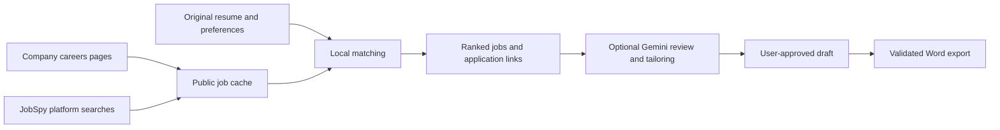

# NextRole

### Find relevant jobs. Tailor your resume. Prepare for the next conversation.

NextRole is a local job-search assistant that connects your resume with public job openings, helps you create a role-specific resume without inventing qualifications, and brings positive recruiter updates into one workspace.

Job discovery and relevance ranking run without an AI API key. Google Gemini is optional for evidence-based fit reviews and resume tailoring.

**[Quick start](#quick-start) · [Features](#features) · [How matching works](#how-matching-works) · [Privacy](#privacy-and-data-storage) · [Development](#development)**

## Features

| Area | What you can do |
| --- | --- |
| Resume-based discovery | Upload a PDF, DOCX or TXT resume, or paste text; match openings against your experience, responsibilities and preferences. |
| Job collection | Collect public company careers pages and search supported platforms through JobSpy. |
| Search preferences | Choose multiple Indian hiring cities, work style and confirmed experience; remote preferences bypass city selection. |
| Fresh jobs | Highlight recent postings and filter by the last 24 or 48 hours using source posting dates. |
| Fit reviews | Review a selected role with Gemini and inspect validated resume/job-description evidence. |
| Resume tailoring | Approve supported wording, summary and ordering suggestions; answer short questions only where useful evidence is missing. |
| Word export | Preview a clean, single-column Calibri resume and download a validated one-page DOCX on supported Windows setups. |
| Recruiter updates | Connect Gmail once to see positive outreach, shortlists, interviews, assessments and offers. |
| Interview preparation | Research company/role interview experiences, questions and patterns, with links to sources and separate general practice. |
| Referral workspace | Find company people or recruiters on LinkedIn and track referral contacts and replies locally. |
| Application writing | Pick formal, friendly or concise cover-letter, recruiter-message and referral-request drafts. |
| Saved jobs and alerts | Save openings, dismiss unsuitable results and discover newly found relevant jobs. |

## Quick start

### Requirements

- **Python 3.12+ recommended** and `pip`.
- A modern browser and internet access for collection and initial setup.
- **Optional:** a Gemini API key for AI fit reviews and tailoring.
- **Windows with desktop Microsoft Word:** required for the current verified one-page export workflow.
- **Windows:** required for the app's saved Gmail credentials, which use Windows DPAPI encryption.

The frontend uses plain JavaScript, HTML and CSS. There is no npm build step.

### 1. Clone and install the optional collectors

```powershell
git clone https://github.com/H-ana/NextRole.git
cd NextRole/nextrole

# Enable local semantic ranking.
python setup_semantic.py

# Enable supported job-platform searches.
python setup_jobspy.py
```

`setup_semantic.py` installs dependencies into `.local-deps/` and downloads a pinned, checksum-verified quantized MiniLM model into `.models/`. `setup_jobspy.py` installs the pinned JobSpy package into `.jobspy-deps/`. Neither installer uploads your resume.

These setups are optional: without the semantic model, search uses full-text ranking; without JobSpy, platform collection is unavailable while company-page collection remains available.

### 2. Start NextRole

```powershell
python start_agent.py
```

Enter your Gemini key at the hidden prompt, or press **Enter** to skip it. The key stays in the backend process environment and is not saved by the launcher.

Open **http://localhost:8081/**. This server serves both the frontend and backend.

To start without the optional key prompt:

```powershell
python server.py --port 8081
```

For a separate frontend preview, use another terminal:

```powershell
python -m http.server 8080 --directory dist
```

Open **http://localhost:8080/** while the backend continues running on port 8081. Use a consistent browser address to retain your locally saved resume and preferences.

### 3. Find your first matches

1. Upload or paste your original resume and review the extracted text.
2. Confirm your total experience, preferred cities and work style.
3. Choose **Find jobs**. Resume import also starts local ranking with your current preferences.
4. Filter by job site or posting age, then open the original application page.
5. Open a job's details for fit review, tailoring, referral tools or application drafts.

Your original resume stays loaded in that browser until you replace or remove it. Tailored drafts never become the source for job matching.

## How matching works



Search first applies location, work-style and clearly stated experience rules. Unknown requirements remain uncertain rather than being treated as verified qualifications.

When the local model is ready, ranking combines semantic similarity with full-text relevance. Semantic matching helps connect related responsibilities even when the exact words differ. During model setup or incomplete indexing, search falls back to full-text ranking.

**Relevance is not eligibility or a hiring probability.** The app keeps three concepts separate:

| Result | Meaning |
| --- | --- |
| Relevance score | A local estimate of how closely the original resume and search context relate to a listing. |
| Strong matches | Roles with a completed AI shortlist review, supported evidence for the reviewed mandatory requirements, and confirmed experience/preference fit. This is a focused review, not an exhaustive eligibility assessment. |
| New matches | Previously unseen results scoring at least 70/100 relevance for an established resume/preferences baseline. Newly discovered does not necessarily mean newly posted. |

Saved jobs, source filters and posting-age filters help organize the results. Duplicate grouping preserves application links and avoids merging clearly distinct requisitions. Internal posting checks exclude certain concrete scam-pattern or stale/reposting signals; missing salary or a short description alone does not exclude a job. These checks do not establish authenticity or an employer's intent to hire.

### Sources and refresh schedules

Company sources are configured in [`nextrole/job_sources.json`](nextrole/job_sources.json). Collection defaults to **HTML-only**, supporting readable HTML and embedded job data. JavaScript-only pages can yield incomplete results.

JobSpy recognizes **LinkedIn, Indeed, Glassdoor, ZipRecruiter, Bayt, Naukri, BDJobs and HelloWork**. Availability varies by country and source: ZipRecruiter coverage is US/Canada, BDJobs is Bangladesh, and HelloWork is France. An installed adapter does not guarantee usable results for every query. No platform login is required by this integration.

| Process | Current behavior |
| --- | --- |
| Company collection | Runs at backend startup, then waits 15 minutes after collection/indexing before the next cycle. |
| Platform searches | Successful queries are cached for six hours; failed sources have a 15-minute cooldown. Later searches trigger eligible refreshes. |
| New-match detection | Rechecks cached results every five minutes while the app is visible, a resume is loaded and no job detail is open. |
| Gmail checks | Approximately every five minutes while the backend runs; opening Notifications also requests a check. |
| Interview research | Cached in backend memory for up to 24 hours; empty-source results use a shorter cache. **Refresh research** requests a fresh attempt. |

Date-only postings use today/yesterday in India rather than claiming an exact posting hour. Listings without a known posting date remain under **Any time**.

Optional browser collection:

```powershell
python setup_scraping.py
```

Then set `"mode": "browser"` in [`scraping_settings.json`](nextrole/scraping_settings.json) and restart the backend. This installs Playwright/Chromium; HTML-only mode needs neither. Collection respects configured hosts and crawling rules and does not bypass login walls, CAPTCHAs or access blocks.

## Resume tailoring and export

Gemini reviews the selected job against the resume after the user grants AI permission. Suggestions use source evidence and undergo validation and a separate factual check.

- Review extraction warnings and approve corrections before AI tailoring.
- Inspect a focused requirement map: **Supported**, **Partially supported**, **Missing** or **Unclear**.
- Add missing evidence through optional clarification questions; the app does not invent accomplishments or metrics.
- Approve wording, summary and ordering changes separately, or apply compatible changes together.
- Preserve names, employers, titles, dates, degrees, certifications, numbers and proficiency claims.
- Keep bullet moves within their original role and preserve employment chronology.

**Simple formatting** provides a local formatting flow without Gemini. **Tailor my resume** adds job-specific, evidence-backed suggestions. Both keep the original matching resume separate.

Word export uses standard-width **Calibri**, readable spacing and a single-column layout. It tries 11, 10.5 and 10-point body text and checks pagination, content preservation and reading order through desktop Word. If the approved content cannot fit one page at the supported minimum size, export stops rather than silently deleting text.

These are document checks, not certification by an employer's ATS or a promise of interview selection. Scanned/image-only PDFs may need OCR outside the app or a pasted text version.

## Gmail and interview preparation

Follow the dedicated **[Gmail setup guide](nextrole/GMAIL_SETUP.md)** to enable Gmail API, create a Desktop OAuth client and authorize read-only access in NextRole.

The recruiter inbox works without marking a job as applied. It checks recent recruitment messages and uses local English-language rules to identify positive actions. Actual rejections, routine job alerts and quoted/forwarded history are excluded. Conditional boilerplate does not override a confirmed shortlist. New mail is prioritized before historical pages; the notification badge refreshes approximately once a minute.

Clicking a notification opens that message in Gmail. The app does not send mail, modify labels or mark Gmail messages as read. The filter can still miss or misclassify messages; it is not sender verification.

The top **Interview prep** tab researches the company and role associated with an invitation or assessment. If either is unclear, you can confirm it before research. The guide:

- Expands role aliases such as SDE, SWE and Software Development Engineer.
- Searches multiple public sources and expands discovery when initial pages cannot be read.
- Separates candidate reports, preparation articles and official employer guidance.
- Shows available source dates, interview patterns, coding questions and source links.
- Labels general DSA, SQL, AI/ML and behavioral practice separately from reported company questions.

Only the company name and role are used in public research queries. Email bodies and resumes are not sent to research sites or Gemini for this feature. Site blocks and limited historical coverage can still prevent extraction; matching links remain available when possible.

## Referrals and outreach

**Find a referral** opens LinkedIn people, recruiter and similar-role searches using the employer and recognized posted location. Verified numeric employer IDs use LinkedIn's Current company filter; other searches use company-name keywords. Results are search leads, not confirmed employees, vacancy owners or guaranteed referral contacts.

Opening a referral search adds the job to **Referrals**. Update the contact name and reply status there, and filter by job ID. LinkedIn inboxes and connection graphs are not synced; replies require manual updates.

Cover-letter, recruiter-message and referral-request tools offer **formal, friendly and concise** tones. Drafts are editable, can be copied, and use **Reset drafts** to restore templates. Nothing is sent automatically.

## Privacy and data storage

NextRole is designed for a **single-user local workspace**, not a public multi-user deployment.

| Data | Where it lives |
| --- | --- |
| Original resume text | Browser local storage, retained until replaced, removed or browser data is cleared. |
| Preferences, saved jobs, referral records and match alerts | Browser local storage. |
| Tailored drafts, clarification answers and AI review results | Memory during the active session; exported documents remain wherever the user saves them. |
| Public job listings, indexes and posting history | Local backend data files. |
| Gmail notification metadata | Private local SQLite database under `nextrole/data/`. This metadata database is not encrypted. |
| Gmail OAuth credentials/tokens | Windows DPAPI-encrypted storage under `nextrole/data/`. |
| Email bodies | Processed in memory; not saved by the app or sent to Gemini. |
| Gemini key entered at startup | Backend process environment; not saved by the launcher. |

Gmail data, credentials, model/dependency folders, export scratch files and development screenshots are ignored by Git. Temporary export files are cleaned up after the export attempt. Do not add real resumes, OAuth JSON files or keys to the repository.

Local matching does not send the resume to Gemini. An approved AI review/tailoring action does send its relevant resume/job inputs to Google. The browser loads PDF/DOCX reader libraries from a CDN, but extraction itself runs locally. Public collection and initial setup still require network access.

## Configuration

Run commands from `nextrole/`.

| Setting | Purpose |
| --- | --- |
| `GEMINI_API_KEY` | Optional backend key for AI actions; the startup prompt can supply it. |
| `GEMINI_MODEL` | Select a model supported by `agent_service.py`; its `DEFAULT_MODEL` defines the default. |
| `GEMINI_THINKING_LEVEL` | Thinking level; the current default is `LOW`. |
| `job_sources.json` | Configured company URLs and allowed hosts. |
| `scraping_settings.json` | HTML-only or optional browser collection. |

See [`.env.example`](nextrole/.env.example) for the environment template. **`.env` files are not loaded automatically.** For example, in PowerShell:

```powershell
$env:GEMINI_THINKING_LEVEL = "LOW"
python start_agent.py
```

Python backend changes require stopping and restarting the process. Frontend changes require a browser reload; use `version_frontend.py` when releasing changed modules so imports share the same cache version.

## Development

### Project layout

```text
NextRole/
├── README.md
└── nextrole/
    ├── dist/                 # Frontend modules, styles and HTML
    ├── server.py             # Loopback HTTP server and API routes
    ├── agent_service.py      # Gemini profiling, fit review and tailoring
    ├── job_store.py          # Job cache, filtering and ranking
    ├── semantic_search.py    # Local embeddings and full-text scoring
    ├── careers_scraper.py    # Company-page collection
    ├── platform_search.py    # JobSpy search orchestration
    ├── jobspy_worker.py      # Isolated platform collector
    ├── recruiter_mail.py     # Local positive-mail classification
    ├── gmail_notifications.py # Gmail OAuth, polling and notification storage
    ├── interview_prep.py     # Public interview-source research
    ├── resume_export.py      # DOCX export and validation
    ├── fit_resume.ps1        # Desktop Word pagination/layout checks
    ├── setup_*.py            # Optional dependency/model installers
    ├── test_*.py             # Backend tests
    └── test-*.mjs            # Frontend/module tests
```

### Run checks

```powershell
cd nextrole
python -m unittest discover -s . -p "test_*.py" -q
```

Frontend tests need Node.js; development has been checked with Node.js 24. Run each file in a separate process. One legacy test expects its production module on standard input:

```powershell
Get-ChildItem -Filter "test-*.mjs" |
    Where-Object Name -ne "test-resume.mjs" |
    ForEach-Object {
        node --preserve-symlinks --preserve-symlinks-main $_.FullName
        if ($LASTEXITCODE -ne 0) { throw "Failed: $($_.Name)" }
    }

Get-Content -Raw -Encoding UTF8 dist/resume-tools.mjs |
    node --preserve-symlinks --preserve-symlinks-main test-resume.mjs
```

Tests use synthetic resumes, mailbox fixtures and model stubs. Real Word pagination, Windows credential encryption and live collection should also be verified in the intended Windows session; automated checks alone do not establish live source availability.

## Troubleshooting

| Symptom | What to check |
| --- | --- |
| Backend unavailable | Run `python start_agent.py`, keep the terminal open and check port 8081. |
| AI request fails or hits quota | Check the configured Gemini key/model and provider quota; local search and simple formatting remain available. |
| No semantic ranking | Run `python setup_semantic.py`, restart the backend and allow indexing to finish. |
| Few platform jobs | Check JobSpy installation, country coverage, source restrictions and the search cache interval. |
| Careers page returns no jobs | HTML-only collection may not see JavaScript content; enable optional browser collection where appropriate. |
| Interview research has no questions | Confirm company/role, use **Refresh research**, or open discovered source links when collection is blocked. |
| Gmail update is missing | Use **Notifications → Check now**; confirm authorization and allow for bounded processing. Forwarded history and purely conditional invitations do not generate alerts. |
| One-page export fails | Ensure desktop Word is installed and available to the backend's Windows account; shorten content through approved edits if it exceeds one page. |
| Resume seems missing | Return to the same browser origin; local storage is separate for `localhost`, `127.0.0.1` and different ports. |

## References and credits

- [JobSpy](https://github.com/speedyapply/JobSpy) for supported platform collection.
- [Sentence Transformers MiniLM](https://huggingface.co/sentence-transformers/all-MiniLM-L6-v2) for local semantic embeddings.
- [Playwright](https://playwright.dev/python/) for optional browser rendering.
- [ATSResume design reference](https://github.com/sauravhathi/atsresume) for structured-builder inspiration.
- [Third-party implementation notes](nextrole/THIRD_PARTY_REFERENCES.md) for integration and attribution details.

No project-wide license is declared in this repository. Dependencies retain their respective licenses.
